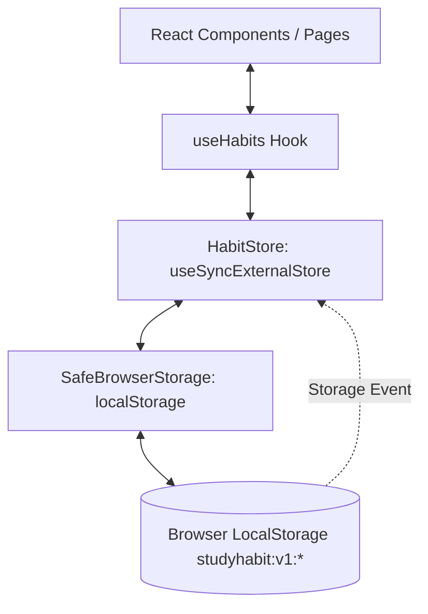

# StudyHabit

> A clean, focused study routine and academic consistency tracker built for students and deep work.

---

## Table of Contents

- [Overview](#overview)
  - [The Problem](#the-problem)
  - [The Solution](#the-solution)
  - [MVP Scope & Purpose](#mvp-scope--purpose)
- [Key Features](#key-features)
- [Screenshots](#screenshots)
- [Technology Stack](#technology-stack)
- [Getting Started](#getting-started)
  - [Prerequisites](#prerequisites)
  - [Installation & Setup](#installation--setup)
- [Project Structure](#project-structure)
- [Application Workflow](#application-workflow)
- [Data Persistence & Architecture](#data-persistence--architecture)
- [Available Scripts & Quality Assurance](#available-scripts--quality-assurance)
- [Scope & Limitations](#scope--limitations)
- [Future Improvements](#future-improvements)
- [License](#license)

---

## Overview

### The Problem
University and high school students frequently struggle with fragmented study schedules, burnout caused by cramming, and a lack of visibility into their daily academic habits. Generic to-do lists treat reading a 50-page biology chapter the same as taking out the trash, while complex project management tools introduce excessive friction that discourages daily engagement.

### The Solution
**StudyHabit** is an intentional, distraction-free study habit tracker designed specifically for students. It emphasizes deliberate daily routines (encouraging 2 to 4 core habits per day), realistic time-boxed study blocks, and academic discipline categorization. Streaks and analytics are calculated strictly from verified daily completions, giving students an honest picture of their academic consistency.

### MVP Scope & Purpose
This Minimum Viable Product (MVP) validates the core habit loop:
1. **Zero-friction onboarding**: Instant access without required registration or cloud setup.
2. **Local-first privacy**: Complete student privacy where data never leaves the user's browser.
3. **Intentional habit management**: Creation, editing, archiving, deletion with historical retention, reordering, and weekly progress analytics.

---

## Key Features

### 1. Habit Creation & Customization
- **Academic Fields**: Define habit titles, assign subjects or course areas (e.g., Computer Science, Mathematics, Biology, History), and add optional focus intent notes (up to 300 characters).
- **Time Targets**: Set daily study durations (5 to 480 minutes) using custom number inputs or quick presets (25m Pomodoro, 45m Deep Focus, 60m Standard, 90m Intensive).
- **Visual Categorization**: Choose from 6 curated student tag tones (Emerald, Navy, Amber, Rose, Slate, Purple) and 3 priority levels (Low, Medium, High).
- **Validation**: Strict client-side validation enforcing character limits, integer duration bounds, and whitespace trimming with clear inline feedback.

### 2. In-Place Habit Editing
- **Unified Form**: Edit any routine via a dedicated edit button without duplicating form logic or losing habit identity.
- **Identity Preservation**: Preserves stable IDs, original creation timestamps, display order, and historical completion records while updating the modification timestamp.

### 3. Daily Completion Tracking
- **Checklist**: Single-click checkbox toggle to log completion for the day.
- **Dynamic Feedback**: Real-time toast alerts acknowledging finished study blocks.
- **Dynamic Subtitle**: Context-aware greetings that summarize remaining sessions or celebrate complete daily checklists.

### 4. Habit Archiving & Restoration
- **Archive Action**: Temporarily retire routines so they no longer clutter active daily views or affect current daily statistics.
- **Preserved History**: Archiving does not erase past completion logs or past weekly data.
- **Archived Tab**: Review all archived habits in a dedicated tab and restore them to active status at any time.

### 5. Habit Reordering
- **Accessible Controls**: Move habits up or down in the daily active routine with dedicated keyboard-accessible buttons.
- **Boundary Guards**: Automatically disables the "Move Up" action for the first habit and the "Move Down" action for the last habit.
- **Index Stability**: Swapping habits preserves relative positions of archived items and leaves completion history unaffected.

### 6. Permanent Deletion with Explicit History Policy
- **Accessible Alert Dialog**: Accessible confirmation dialog (`role="alertdialog"`) that prevents accidental removals.
- **Documented History Retention Policy**:
  - **Default Policy (Historical Record Retention)**: Permanently removes the habit definition while preserving past completion logs as historical records to protect lifetime study stats and past consistency records.
  - **Optional Cascade Purge**: A checkbox allows users to deliberately purge all historical completion logs associated with that habit if desired.

### 7. Consistency Analytics & KPIs
- **Daily Summaries**: Tracks overall completion rate (%), number of completed vs. scheduled routines, and total planned study minutes.
- **Consecutive Streaks**: Displays consecutive daily check-in streaks per habit and identifies peak streaks across active routines.
- **7-Day Weekly Calendar Strip**: Visualizes Monday-to-Sunday execution with progress indicators and fractions (`X/Y`). Includes a "Sample Preview" toggle strictly for UI evaluation without touching live student data.
- **Subject Allocation Breakdown**: Visualizes target study time per academic discipline, complete with percentage share bars.

---

## Screenshots

> *Add application screenshots below to showcase the visual interface.*


```

---

## Technology Stack

| Layer / Tool | Technology | Version | Purpose |
| :--- | :--- | :--- | :--- |
| **Framework** | [Next.js](https://nextjs.org/) (App Router) | `16.4.3` | React server/client architecture, static prerendering, and optimized asset pipelines. |
| **UI Library** | [React](https://react.dev/) | `19.3.0` | Declarative component UI and external store synchronization via `useSyncExternalStore`. |
| **Language** | [TypeScript](https://www.typescriptlang.org/) | `5.x` | Strict type safety, domain models, and validation typeguards. |
| **Styling** | [Tailwind CSS](https://tailwindcss.com/) & Turbopack | `4.3.3` | Utility-first CSS engine with custom academic color tokens and glassmorphism styling. |
| **Icons** | [Lucide React](https://lucide.dev/) | `1.63.0` | Consistent, accessible iconography. |
| **CSS Utilities** | `clsx` & `tailwind-merge` | `2.1.1` / `3.7.0` | Safe conditional class merging. |
| **Testing** | Node.js Native Test Runner (`node:test`) | Node 20+ | Fast, zero-dependency unit and domain logic testing. |
| **ESM Loader** | `jiti` | Built-in | Runtime TypeScript module resolution for native test execution. |

---

## Getting Started

### Prerequisites
- **Node.js**: `v20.0.0` or higher (verified on Node `v24.x`).
- **npm**: `v10.0.0` or higher.
- A modern web browser (Chrome, Firefox, Safari, or Edge) with local storage enabled.

### Installation & Setup

1. **Clone the repository**:
   ```bash
   git clone https://github.com/your-username/studyhabit.git
   cd studyhabit
   ```

2. **Install dependencies**:
   ```bash
   npm install
   ```

3. **Environment variables**:
   This MVP operates entirely local-first using browser storage. **No external API keys or `.env` configuration are required** to run the application.

4. **Start the development server**:
   ```bash
   npm run dev
   ```

5. **Open the application**:
   Open [http://localhost:3000](http://localhost:3000) in your web browser.

---

## Project Structure

```text
StudyHabit/
├── app/                                # Next.js App Router routes & layouts
│   ├── habits/page.tsx                 # /habits — Habit routine configuration & management
│   ├── progress/page.tsx               # /progress — Long-term consistency & subject allocation
│   ├── globals.css                     # Tailwind v4 import & CSS custom properties
│   ├── layout.tsx                      # Root layout with metadata and HTML wrapper
│   └── page.tsx                        # / — Overview dashboard with daily checklist
├── components/                         # React presentational and container components
│   ├── habits/                         # Habit domain components
│   │   ├── add-habit-modal.tsx         # Add modal wrapper (delegates to HabitFormModal)
│   │   ├── delete-habit-dialog.tsx     # Accessible deletion confirmation dialog
│   │   ├── habit-card.tsx              # Habit card with checkbox, reordering, and action buttons
│   │   ├── habit-form-modal.tsx        # Unified create & edit habit modal dialog
│   │   ├── habit-list.tsx              # Filterable habit list (All, Pending, Completed, High Priority, Archived)
│   │   ├── habit-stats-overview.tsx    # 4 KPI summary cards (Progress, Count, Time, Streak)
│   │   ├── habits-client-container.tsx # Main dashboard client controller
│   │   ├── my-habits-container.tsx     # Habit management page client controller
│   │   ├── progress-container.tsx      # Academic progress & subject allocation controller
│   │   └── weekly-progress-view.tsx    # Monday–Sunday weekly progress visualization
│   ├── layout/                         # Application layout primitives
│   │   ├── app-header.tsx              # Responsive top navigation bar with date badge
│   │   ├── app-shell.tsx               # Layout wrapper with sidebar and mobile navigation
│   │   ├── app-sidebar.tsx             # Desktop navigation sidebar
│   │   ├── footer.tsx                  # Application footer with local-first indicator
│   │   └── page-container.tsx          # Centered responsive content container
│   └── ui/                             # Reusable design system primitives
│       ├── alert.tsx                   # Dismissible feedback alerts
│       ├── badge.tsx                   # Tag and status badges with color theme variants
│       ├── button.tsx                  # Accessible button component with variant styles
│       ├── card.tsx                    # Content card wrapper
│       ├── empty-state.tsx             # Polished empty state with action CTAs
│       ├── progress-bar.tsx            # Animated progress bar
│       └── summary-card.tsx            # KPI metric cards with progress bars
├── hooks/
│   └── use-habits.ts                   # Custom React hook connecting components to HabitStore
├── lib/
│   ├── habits/
│   │   ├── domain.ts                   # Pure domain business logic, streak calculation, and validation
│   │   ├── habit-store.ts              # In-memory store and window storage listener
│   │   └── weekly.ts                   # Monday-to-Sunday calendar calculations
│   ├── storage/
│   │   └── safe-storage.ts             # Safe localStorage abstraction with schema validation
│   └── utils.ts                        # Duration formatting and cn() class utility
├── tests/
│   ├── habits.test.ts                  # Comprehensive unit tests for domain logic
│   └── run-tests.mjs                   # Fast test runner using jiti and node:test
├── types/
│   ├── habit.ts                        # TypeScript interfaces (StudyHabit, HabitLogEntry, etc.)
│   └── storage.ts                      # Storage abstraction interfaces
├── package.json                        # Project dependencies and npm scripts
├── package-lock.json                   # Deterministic package dependency tree
└── tsconfig.json                       # TypeScript compiler configuration
```

---

## Application Workflow

1. **Dashboard Access (`/`)**:
   - The user opens the dashboard and sees the time-based greeting, today's date, 4 summary KPI cards, and the 7-day consistency calendar.
   - Initial starter routines (Deep Work, Active Recall, Notes Review) are loaded automatically for immediate evaluation.
2. **Create / Edit Routine**:
   - Click **"Add Habit"** to open the modal. Specify title, subject, target minutes (or preset), priority, and color tone.
   - Click the **pencil icon** on any habit card to edit its details in place while preserving history.
3. **Daily Execution & Check-off**:
   - Check off habits as study sessions are completed.
   - Completion rate immediately updates, study volume reflects logged minutes, and consecutive streaks increment.
4. **Organize Routines**:
   - Use the **Move Up / Move Down** arrows to arrange active habits in the preferred sequence.
   - Filter the list by **Pending Today**, **Completed**, or **High Priority**.
5. **Archive / Delete**:
   - Click **Archive** to remove a routine from today's checklist while keeping its historical record.
   - View archived items under the **Archived** tab and click **Restore** to reactivate them.
   - Click the **trash icon** to trigger an accessible deletion dialog with options to retain or purge historical completion logs.
6. **Progress Review (`/progress`)**:
   - Inspect subject study time allocations, verify active streaks, and review lifetime verified check-ins.

---

## Data Persistence & Architecture



- **Storage Engine**: Data is stored under the `studyhabit:v1:` namespace in the browser's `localStorage`.
- **Validation on Load**: Data read from storage passes through TypeScript typeguards (`isStudyHabitsArray`, `isHabitLogsArray`). If data is corrupt or malformed, the app falls back to default seed data gracefully without crashing.
- **Cross-Tab Synchronization**: Changes in one browser tab are immediately broadcast to other open tabs via the native `window` storage event listener.
- **SSR Safe**: Initial server rendering utilizes static snapshot fallbacks, eliminating hydration mismatch errors and layout shifts.

---

## Available Scripts & Quality Assurance

All available commands are configured in `package.json`:

| Command | Action |
| :--- | :--- |
| `npm run dev` | Starts the Next.js development server with Turbopack at `localhost:3000`. |
| `npm run build` | Compiles an optimized production build using Webpack. |
| `npm run start` | Starts the production Next.js server following `npm run build`. |
| `npm run lint` | Runs ESLint 9 across all TypeScript and React source files. |
| `npm run typecheck` | Executes TypeScript type checking (`tsc --noEmit`) with strict checking enabled. |
| `npm test` | Runs the automated domain test suite using Node's native test runner. |

---

## Scope & Limitations

This repository is intentionally structured as a focused MVP. The current release has the following architectural boundaries:

- **Local Storage Only**: Data is stored exclusively in the user's browser. There is no cloud database, remote sync, or cross-browser data sharing.
- **Single-User / No Authentication**: Designed for single-student personal use on one device; no user login or account system is implemented.
- **Fixed Daily Cadence**: Habits are structured around daily targets. Advanced recurring rules (e.g., alternating every two weeks or specific weekday schedules) are not part of this release.
- **Local Date Handling**: Day calculations and streaks operate based on the client browser's local timezone.

---

## Future Improvements

Potential enhancements identified for post-MVP iterations:

- **Data Export & Import**: Ability to backup and restore study habits and completion logs as JSON or CSV files.
- **Built-in Focus Timer**: An integrated Pomodoro/stopwatch timer that directly checks off a habit once the target duration has elapsed.
- **Custom Cadences**: Support for weekday-specific schedules (e.g., Monday/Wednesday/Friday routines).
- **Cloud Synchronization & Accounts**: Optional encrypted synchronization across devices using Supabase or Firebase.
- **Dark Mode Theme**: Theme toggle for late-night study sessions.

---

## License

This repository currently has **no declared license**. All rights are reserved by the original author. If you wish to use, modify, or distribute this project, please obtain permission from the repository owner.
